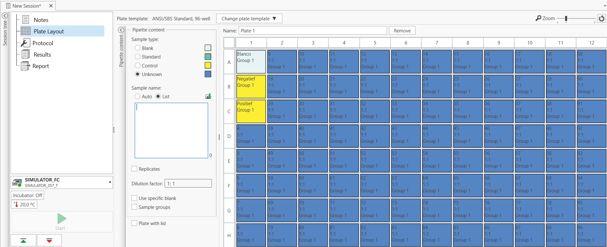
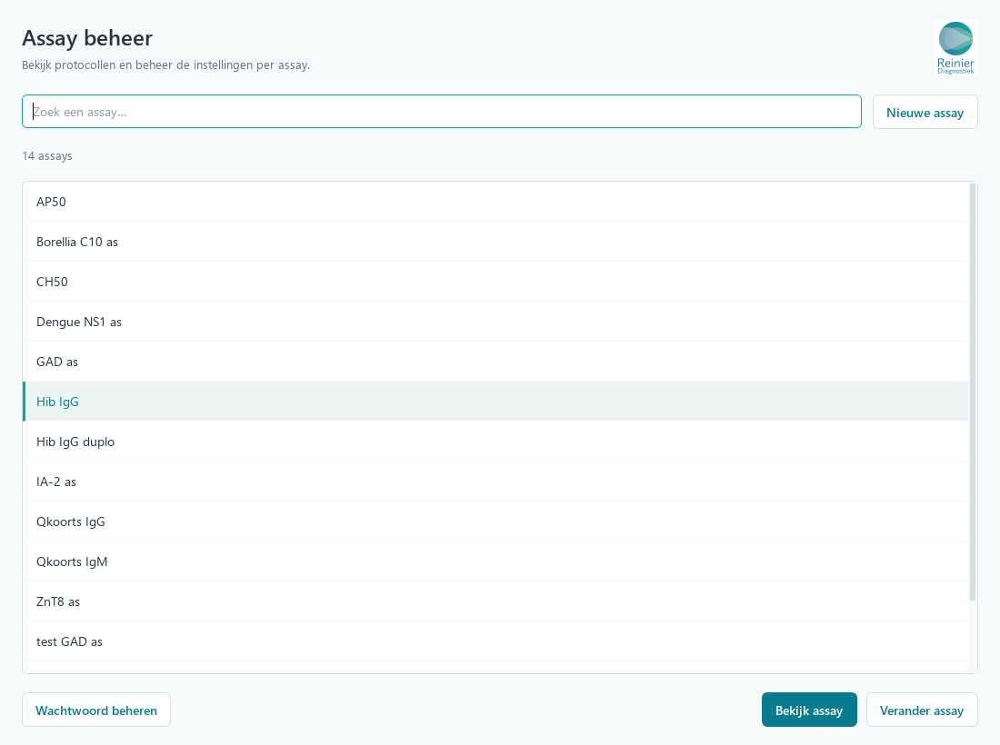
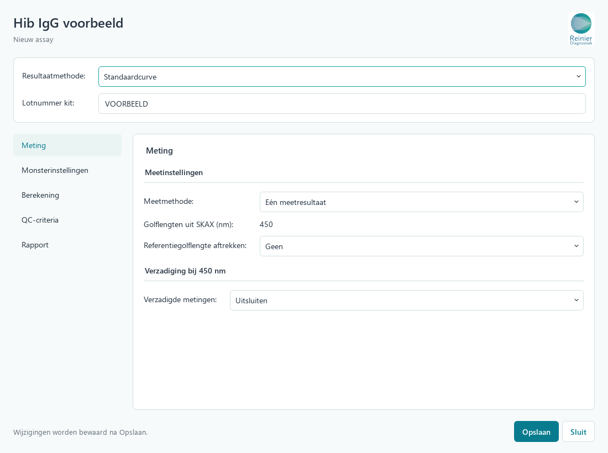
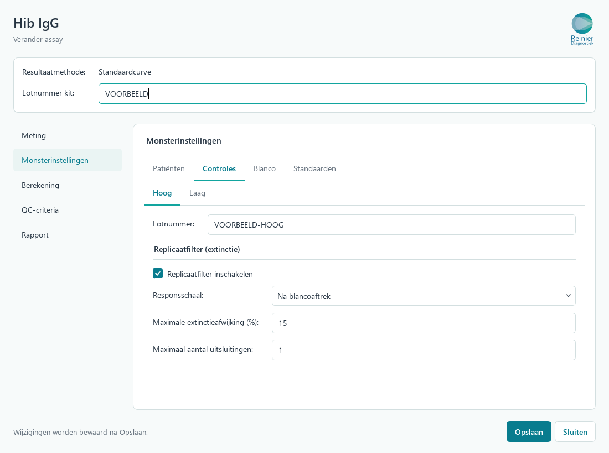
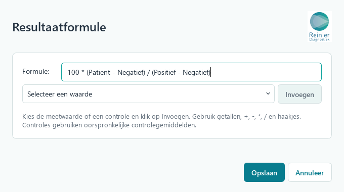
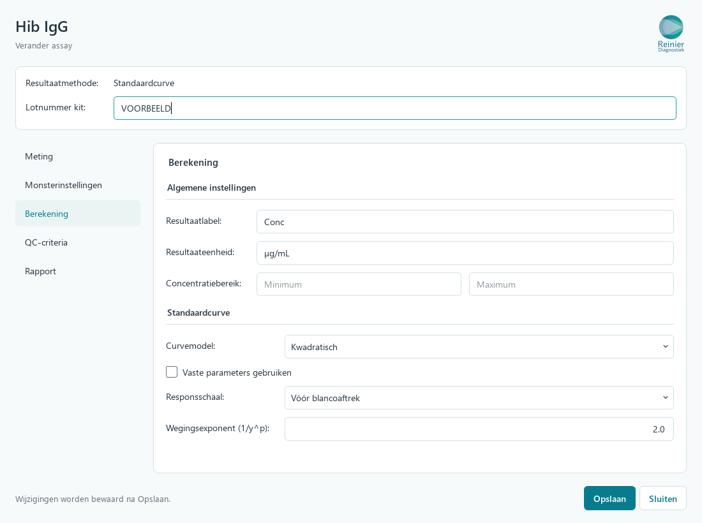
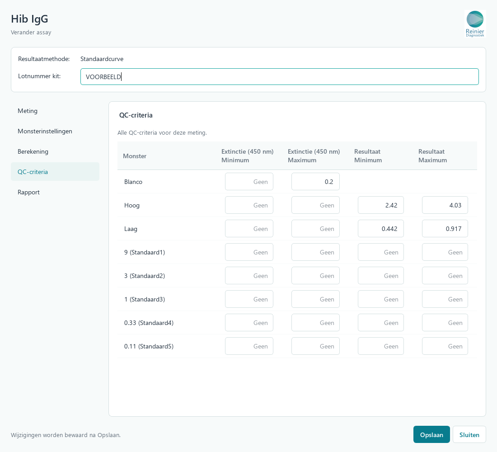
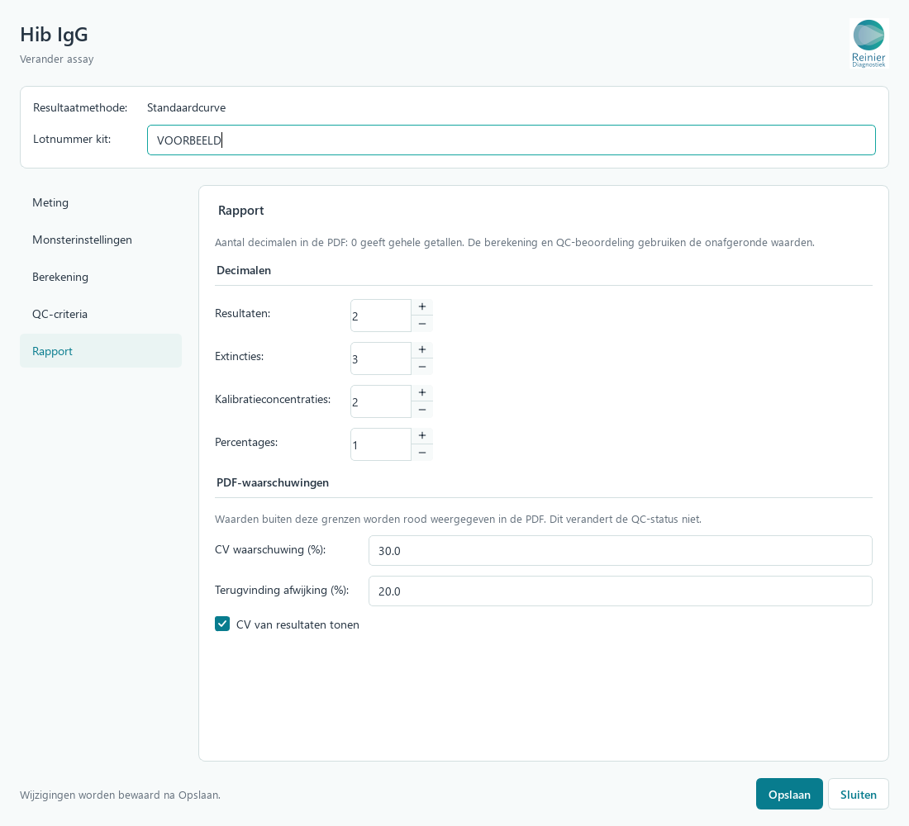

Assay beheer
============

.. _protocol-voorbereiden:

Nieuw protocol maken in SkanIt
-------------------------------

1. Kies **New → Multiskan FC**.
2. Vul **Plate Layout** in. Gebruik **Blank**, **Control**, **Standard** en **Unknown** voor de juiste
   monstertypen en gebruik duidelijke namen voor de controles, en nummers voor patiënten.
3. Voeg onder **Protocol → Absorbance** de benodigde golflengten toe.
   Gebruik **Measurement Mode → Normal** voor de hoogste precisie.
4. Voeg géén berkeningen, blanco-aftrekkingen of curve-fits uit onder **Results**.
5. Onder **Report** kan alles uitgezet worden, ElisaFlow heeft alleen het .skax bestand nodig.
6. Sla het protocol ergens tijdelijk op met een duidelijke assaynaam, gebruik underscores in plaats van spaties.

.. _protocol-toevoegen-en-wijzigen:

Een protocol toevoegen of wijzigen
-------------------------------------------------

1. Stel het wachtwoord in via **Wachtwoord beheren** als dit nog niet gedaan is.
2. Kies **Nieuwe assay** en selecteer een .skax bestand gemaakt onder :ref:`protocol maken <protocol-voorbereiden>`.
3. Kies **Resultaatmethode → Berekening** voor een formule, of
   **Standaardcurve** voor concentratieberekening. Vul ook **Lotnummer kit** in.
4. Vul de tabjes: :ref:`Meting <instellingen-meting>`, :ref:`Monsterinstellingen <instellingen-monsters>`, :ref:`Berekening <instellingen-berekening>`, :ref:`QC-criteria <instellingen-qc>` en :ref:`Rapport <instellingen-rapport>` in en klik op **Opslaan**.

Open **Bekijk assay** om de opgeslagen instellingen te controleren en. 
Wijzingen  kunnen gedaan worden door op **Verander assay** te klikken, dit is beveiligd met een wachtwoord. 
Wijzigingen worden pas bewaard na **Opslaan**, waarbij de oude instellingen van de assay bewaard worden in een aparte map.

.. _instellingen-meting:

Meting
------

.. list-table::
   :header-rows: 1
   :widths: 42 58

   * - Instelling
     - Uitleg
   * - **Meetmethode**
     - **Eén meetresultaat** als dezelfde golflengte wordt gebruikt voor alle resultaten.
       **Twee golflengten; omschakelen op concentratie**, als er gewisseld moet worden van golflengte vanaf een bepaalde concentratie.
   * - **Referentiegolflengte aftrekken**
     - De achtergrondgolflengte (meestal 620nm) die van elke golflengte meting kan worden afgetrokken, standaard **Geen**.
   * - **Voorkeursgolflengte**
     - De golflengte voor resultaten ónder de omschakelconcentratie.
   * - **Omschakelconcentratie (vóór verdunningscorrectie)**
     - Vanaf deze concentratie schakelt een monster oven naar de andere golflengte.
   * - **Verzadigde metingen**
     - Standaard **Uitsluiten**. Bij **Berekenen uit een andere golflengte**
       zijn **Brongolflengte**, **Helling** en **Intercept** verplicht.

Gebruik voor verzadigingsomrekening vooraf vastgelegde coëfficiënten voor de
assay en reader. Zie :ref:`correcties` en :ref:`golflengteselectie` voor de rekenregels.

.. _instellingen-monsters:

Monsterinstellingen
-------------------

Vul **Lotnummers** in onder **Controles**, **Blanco** en **Standaarden** als deze aanwezig zijn.
De namen en standaardconcentraties komen uit het protocol en kunnen niet worden aangepast.

Voor patiënten, een controle of een standaard kan een **Replicaatfilter**
worden ingeschakeld, die een afwijkende duplo kan verwijderen. Stel de maximale 
extinctieafwijking en het maximale aantal uitsluitingen in. Kies bij ieder filter
de **Responsschaal**: **Vóór blancoaftrek** of **Na blancoaftrek**.
Zie :ref:`replicaatfilter` voor de berekening.

.. _instellingen-berekening:

Berekening
----------

Vul **Resultaatlabel** en eventueel **Resultaateenheid** voor een concentratie uitslage in.

**Bij een formule:** kies per formule een **Responsschaal**:
**Vóór blancoaftrek** of **Na blancoaftrek**.
Open daarna **Patiënten → Formule → Bewerken…**.
Selecteer een meetwaarde of controle, klik op **Invoegen** en
bouw de formule op met getallen, haakjes en ``+``, ``-``, ``*``, ``/``.
Sla de formule op en bewaar daarna de assay met **Opslaan**.
Zie :ref:`resultaatformules` voor een voorbeeld.

Onder **Controles** gebruikt **Zelfde formule, invoerschaal, resultaatlabel en eenheid als
patiënten** de patiëntinstellingen. Haal het vinkje weg om ze per
controle aan te passen.

**Bij een standaardcurve:** kies **Curvemodel** en **Wegingsexponent (1/y^p)**.
Sommige kits geven de curve en parameters mee met de kit, schakel hiervoor **Vaste parameters gebruiken** 
in en vul je alle parameters in. **Responsschaal** is beschikbaar voor zowel curve-fits
als vaste curven, de fit kan **Vóór blancoaftrek** of **Na blancoaftrek** gedaan worden.

**Concentratiebereik** beperkt het rapportagebereik; bij een vaste
kwadratische of kubische curve is het verplicht. Bij vaste parameters voegt
**Voorbewerking → Bewerken…** optioneel een omrekenformule toe. Als je vaste
parameters uitschakelt, wordt deze formule verwijderd. Bij twee analysegolflengten stel je
model, vaste parameters en voorbewerking op ieder golflengtetabblad afzonderlijk in.
Resultaatlabel, eenheid en concentratiebereik zijn gedeeld.

Een uitgebreider overzicht van de modellen en instellingen voor curve-fitting staan in :doc:`calibration`.

.. _instellingen-qc:

QC-criteria
-----------

Vul de benodigde **Minimum**- en **Maximum**-waarden in voor blanco, controles
en standaarden waar nodig. Gebruik **Extinctie** voor meetwaarden en **Resultaat** voor
berekende uitslagen of concentraties. Bij meerdere analysegolflengten staan extinctiegrenzen onder
de **Meting**-tabs en resultaatgrenzen onder **Resultaat**.
Kies bij iedere controle of standaard weer de extinctieschaal: **Vóór blancoaftrek**
of **Na blancoaftrek**.
Zie :doc:`validation` voor de beoordeelde waarden en statusregels.

.. _instellingen-rapport:

Rapport
-------

Stel onder **Decimalen** de weergave van resultaten, extincties,
kalibratieconcentraties en percentages in, van 0 tot en met 6 decimalen.

Onder **PDF-waarschuwingen** bepaal je **CV waarschuwing (%)**, en bij een
standaardcurve de maximale **Terugvinding afwijking (%)**. Beide zijn standaard 20%
en bedoeld als waarschuwing, niet als QC-criteria. Waarden die hier buiten vallen worden rood gekleurd.
Met **CV van resultaten tonen** kan gekozen worden of resultaat-CV's getoond worden.

Zie :doc:`report` voor het lezen van het rapport.
